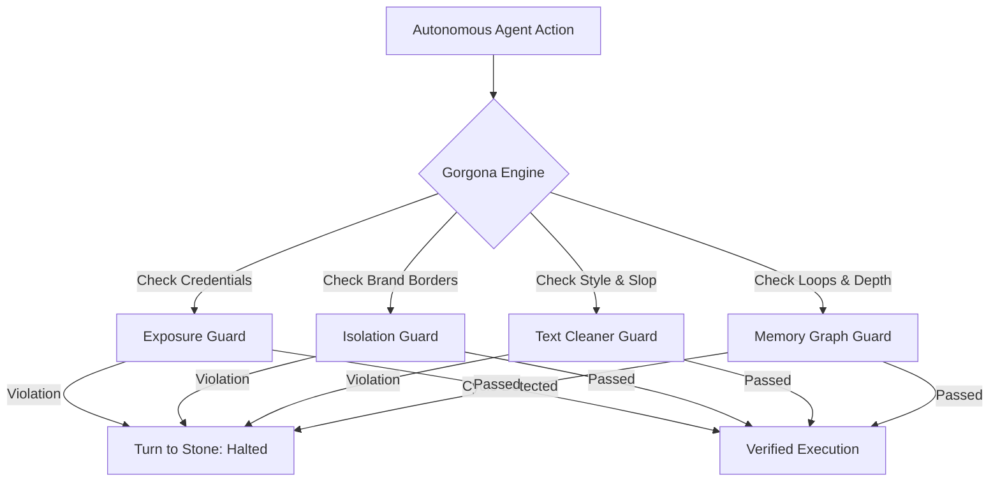

<div align="center">

# GORGONA

**Turn runaway AI agents to stone.**  
*The deterministic guardrail engine, model router, and execution discipline for autonomous AI agents.*

<br/>


<br/>

[](https://www.python.org/downloads/)
[](https://opensource.org/licenses/MIT)
[](https://github.com/adrianpeticila/gorgona)
[](https://github.com/adrianpeticila/gorgona)

</div>

---

> **GORGONA** is the operating system I built to run a portfolio of brands with AI. Alone. To survive that without burning $500/mo on tokens or leaking identities, you have to turn runaway agents to stone.

---

## Why Gorgona?

Most AI agent frameworks are built with recursive, probabilistic loops. When things go wrong, agents burn through API credits, contaminate repository contexts, or hallucinate credentials.

Gorgona takes the opposite stance:
- **Deterministic control**: Agents operate under strict, uncompromising rules.
- **Zero dependencies**: Pure standard library Python 3.10+. Zero pip bloat. Zero telemetry.
- **Fail-safe stone mode**: Runaway or leaking agents are instantly frozen.



---

## Quickstart (30 Seconds)

### 1. Installation

Install directly in editable mode or via pip:

```bash
git clone https://github.com/adrianpeticila/gorgona.git
cd gorgona
pip install -e .
```

### 2. Verify System Health

Run the built-in diagnostic doctor:

```bash
gorgona doctor
```

Output:
```text
  ____ ___  ____   ____  ___  _   _    _    
 / ___/ _ \|  _ \ / ___|/ _ \| \ | |  / \   
| |  | | | | |_) | |  _| | | |  \| | / _ \  
| |__| |_| |  _ <| |_| | |_| | |\  |/ ___ \ 
 \____\___/|_| \_\\____|\___/|_| \_/_/   \_\
    
  GORGONA v0.1.0 - Autonomous Agent Guardrail Engine
  Turn runaway AI agents to stone.

Checking Gorgona installation and environment integrity...

  [PASS] Python Version (>= 3.10): Python 3.10+
  [PASS] Zero Dependencies Policy: Zero external pip dependencies required
  [PASS] Guard Module: ExposureGuard: Loaded
  [PASS] Guard Module: IsolationGuard: Loaded
  [PASS] Guard Module: TextCleanerGuard: Loaded
  [PASS] Guard Module: MemoryGraphGuard: Loaded

System healthy and ready.
```

### 3. Scan a Directory or File

Scan any project tree for secrets, brand leakages, or AI slop:

```bash
gorgona scan ./my-agent-output
```

---

## Python API

Use Gorgona programmatically in your agent workflows:

```python
from gorgona import ExposureGuard, IsolationGuard, TextCleanerGuard, MemoryGraphGuard

# 1. Prevent secret leakage
exposure = ExposureGuard()
findings = exposure.scan_text("sk-abcdef1234567890abcdef123456")
assert len(findings) > 0

# 2. Prevent brand context contamination
isolation = IsolationGuard({"BrandAlpha": ["BrandBetaSecret", "ClientConfidential"]})
violations = isolation.check_content("BrandAlpha", "Deploying changes with ClientConfidential notes.")
assert len(violations) > 0

# 3. Prevent AI slop and banned characters
cleaner = TextCleanerGuard(ban_em_dash=True)
issues = cleaner.scan("Let us delve into this vibrant ecosystem.")
assert len(issues) > 0

# 4. Prevent runaway loops
graph = MemoryGraphGuard(max_depth=5, repetition_threshold=3)
loop_report = graph.record_step("call_tool_read_file")
```

---

## Architecture & Modules

- **`gorgona.guards.exposure`**: High-entropy regex pattern matching and forbidden file scanners.
- **`gorgona.guards.isolation`**: Multi-tenant namespace boundaries to avoid cross-client context bleed.
- **`gorgona.guards.text_clean`**: Anti-slop analyzer and zero em-dash policy enforcer.
- **`gorgona.guards.memory_graph`**: Graph DFS cycle detection and recursion depth circuit breakers.

---

## License

MIT License. Crafted with discipline by Adrian M. Peticila.
