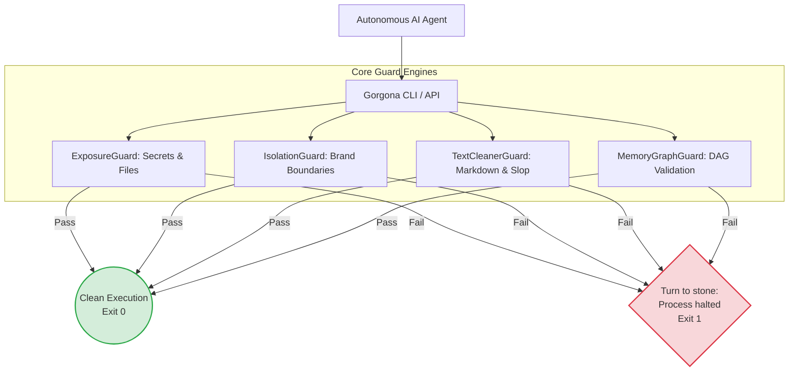

# Gorgona v0.2.0 - Deterministic Guardrail Engine for Autonomous AI Agents


-success.svg)
[](tests/)
[](LICENSE)

```text
  ____ ___  ____   ____  ___  _   _    _
 / ___/ _ \|  _ \ / ___|/ _ \| \ | |  / \
| |  | | | | |_) | |  _| | | |  \| | / _ \
| |__| |_| |  _ <| |_| | |_| | |\  |/ ___ \
 \____\___/|_| \_\\____|\___/|_| \_/_/   \_\

  GORGONA v0.2.0 - Autonomous Agent Guardrail Engine
  Turn runaway AI agents to stone.
```

## The Value Proposition: Why Gorgona?

Most agent guardrails fail because they are slow, non-deterministic, or overly complex.
- **Bloated Dependencies:** AI tooling is often riddled with massive ML libraries.
- **Non-deterministic LLM Evaluators:** "LLM-as-a-judge" is flaky, slow, and expensive.
- **Latency:** High cold start times bottleneck agent pipelines.

**Gorgona wins because:**
- **Sub-10ms Cold Start:** Starts instantly.
- **Zero External Dependencies:** Built entirely on the Python Standard Library.
- **Mathematically Deterministic Gates:** Rules are hard-coded, regex-backed, and graph-validated. No probabilistic guessing. If a condition is met, the process is halted immediately.

## Architecture & Guard Engines



## CLI Reference

Gorgona provides 6 CLI commands designed to easily integrate into CI/CD pipelines, agent pre-flight checks, and cron jobs.

### `gorgona doctor`
Dynamic canary verification suite. Validates the health of your Python environment and runs synthetic tests against all guard engines to ensure they fail when they are supposed to.
```bash
gorgona doctor
```

### `gorgona scan`
Recursive scan for secrets (PATs, `sk-proj-`, generic tokens), forbidden files (e.g., `.env`), and prose slop.
```bash
gorgona scan [PATH] [--max-files N]
```

### `gorgona guard-isolation`
Brand boundary isolation with word-boundary accuracy.
```bash
gorgona guard-isolation [PATH] [--brand BRAND] [--rules RULES_JSON] [--terms TERMS...]
```

### `gorgona clean`
Syntax-aware markdown sanitizer. Fixes em/en dashes, invisible unicode, and prose slop while meticulously preserving code blocks (`...` and ```...```).
```bash
gorgona clean [PATH] [--fix] [--dry-run]
```

### `gorgona lint-memory`
Memory graph linter. Validates frontmatter YAML, enforces case-normalized wiki-links, and performs Depth-First Search (DFS) cycle detection to prevent agents from falling into infinite context loops.
```bash
gorgona lint-memory [PATH]
```

### `gorgona init`
Safe workspace initialization with collision guard.
```bash
gorgona init [PATH] [--force]
```

## Python API Usage

```python
from gorgona import ExposureGuard, IsolationGuard, TextCleanerGuard, MemoryGraphGuard
from pathlib import Path

# 1. Exposure Guard - Secret & Forbidden File Detection
exposure = ExposureGuard()
findings = exposure.scan_text("sk-proj-abcdef1234567890abcdef123456")
path_findings = exposure.scan_path(Path("./agent_workspace"))

# 2. Isolation Guard - Brand & Tenant Boundaries
isolation = IsolationGuard(brand_rules={"BrandAlpha": {"BrandBeta": ["BrandBetaSecret"]}})
violations = isolation.check_content("BrandAlpha", "Using BrandBetaSecret in BrandAlpha context")

# 3. Text Cleaner Guard - Anti-Slop & Typography Sanitizer
cleaner = TextCleanerGuard()
cleaned_text = cleaner.clean("Let's delve into this \u2014 clean result.")

# 4. Memory Graph Guard - Loop Prevention & Graph Cycles
graph = MemoryGraphGuard(max_depth=8, repetition_threshold=3)
graph.add_edge("PlanA", "PlanB")
graph.add_edge("PlanB", "PlanA")
has_cycle, cycle_path = graph.detect_graph_cycle()  # (True, ['PlanA', 'PlanB', 'PlanA'])
```


## Verification & Test Suite

Gorgona is meticulously tested.
**37/37 unit tests pass in ~0.8s** with zero external dependencies.

Run the test suite using `unittest`:
```bash
python -m unittest discover tests
```
